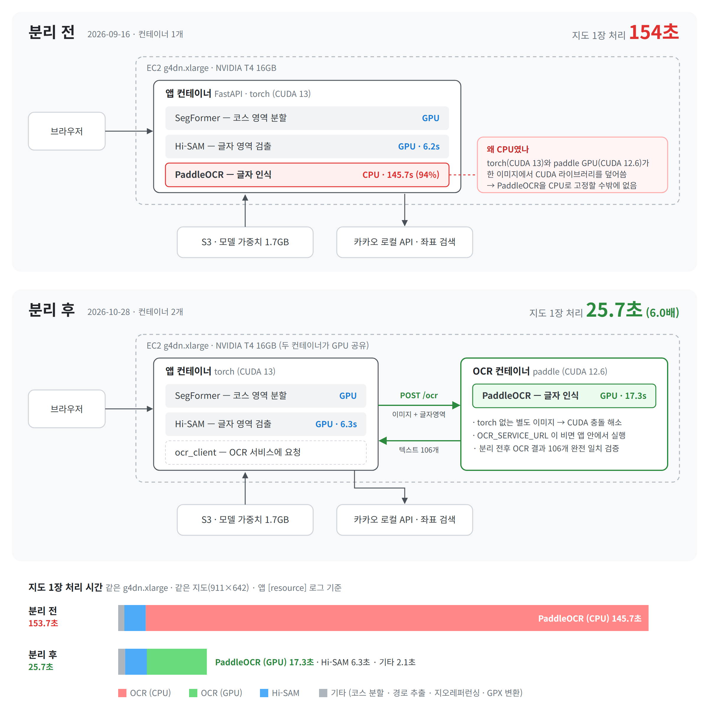

# marathon-gpx-cloud

마라톤 코스 지도 이미지에서 경로를 추출해 지리좌표(GPX)로 변환하는 AI 서비스입니다.
로컬에서만 동작하던 캡스톤 프로젝트를 **실서비스 운영을 목표로 AWS 클라우드에 옮기며 고도화하고 있는 개인 프로젝트**입니다.

| 구분 | 범위 | 기간 |
|------|------|------|
| 캡스톤 팀 프로젝트 | 경로 추출 모델, 후처리·그래프 단순화, 지리좌표 변환 파이프라인, 웹 UI | ~ 2026-05 (이 레포의 커밋 기록 기준 2026-05-12 ~ 05-20) |
| **개인 작업 (이 레포)** | 컨테이너화, 성능 병목 진단, OCR 서비스 분리·GPU 전환, Terraform 인프라 | 2026-09 ~ |

- 원본 팀 레포: [jwonni/Capston-A-man-of-Gyeongsang-do](https://github.com/jwonni/Capston-A-man-of-Gyeongsang-do) — 팀 커밋 기록은 이 레포에 그대로 보존되어 있습니다
- 팀 프로젝트에서 본인 담당: _(작성 예정)_

## 핵심 성과



| 지표 | 개선 전 | 개선 후 | 무엇을 바꿨나 |
|------|---------|---------|---------------|
| 지도 1장 전체 처리 시간 (EC2 g4dn.xlarge) | 약 154초 | **약 25.7초 (6.0배)** | PaddleOCR GPU 전환 + OCR 서비스 분리 |
| └ OCR 구간 | 약 145초 (CPU, 전체의 94%) | 17.3초 (GPU) | 〃 |
| 의존성 수정 후 이미지 재빌드 | 1,430~2,500초 | **248초** | torch 레이어 분리 + pip 캐시 마운트 |
| Docker 빌드 컨텍스트 | 1.8GB | **1.9MB** | 모델 가중치를 이미지에서 분리 |
| GPU 실험 환경 구성 | 콘솔 수작업 (AMI·디스크·IAM 실수 반복) | **`terraform apply` 1회** | Terraform 코드화 + S3 원격 state·락 |

- 같은 인스턴스 타입·같은 벤치마크 지도·같은 측정 로그(`[resource]`)로 비교했습니다
- OCR 분리 전후 결과가 같은지 Hi-SAM 출력을 고정해 검증했습니다 (텍스트 106개, 글자·좌표·신뢰도 완전 일치)
- 모든 결정의 근거와 측정 조건은 [docs/decision-log.md](docs/decision-log.md)에 있습니다

## 주요 기능

1. **경로 마스크 추출** — SegFormer-UNet B2 / U-Net 모델로 마라톤 코스 이미지에서 경로 마스크 예측
2. **후처리** — 연결 성분 필터링 + 스켈레톤화
3. **그래프 단순화** — 스켈레톤을 5단계 파이프라인으로 의미론적 그래프 G′로 압축
4. **경로 추출** — G′에서 BFS 탐색 후 엣지 픽셀 복원 + 꺾임점 기반 키포인트 추출 (시작·끝점 자동 결정 지원)
5. **지리좌표 변환** — Hi-SAM 텍스트 감지 → PaddleOCR → 카카오 Local API → 호모그래피로 픽셀↔GPS 변환
6. **GPX 출력** — 변환된 GPS 좌표를 GPX 파일로 내보내기

개인 작업으로 추가된 기능:

7. **OCR 서비스 분리** — PaddleOCR을 별도 컨테이너(`ocr_service.py`)로 분리해 GPU로 실행. `OCR_SERVICE_URL`이 없으면 기존처럼 앱 안에서 실행
8. **요청별 자원 측정** — 모든 API 요청의 처리 시간·RAM·VRAM·CPU를 `[resource]` 로그로 기록
9. **인프라 코드화** — GPU EC2·보안 그룹·IAM 역할을 Terraform으로 생성/삭제, state는 S3에 보관

## 아키텍처

```
브라우저 ──▶ 앱 컨테이너 (FastAPI, :8010)                     OCR 컨테이너 (FastAPI, :8020)
            torch (CUDA 13)                                  paddle (CUDA 12.6)
            ├─ SegFormer-UNet  ── GPU                         └─ PaddleOCR ── GPU
            ├─ Hi-SAM          ── GPU
            └─ ocr_client ──── POST /ocr (이미지 + 글자 영역) ──▶
                          ◀──── 인식 텍스트 + 좌표 ─────────────
                │
                ├─▶ 카카오 Local API (좌표 검색)
                └─▶ S3 (모델 가중치 1.7GB, 실행 시 다운로드)
```

**왜 컨테이너를 나눴나:** torch(CUDA 13)와 paddlepaddle-gpu(CUDA 12.6)를 한 이미지에 설치하면 각자의 CUDA 라이브러리가 서로를 덮어써 torch가 깨집니다. 그래서 PaddleOCR은 CPU로 고정할 수밖에 없었고, 이것이 전체 처리 시간의 94%를 차지하는 병목이었습니다. OCR을 torch 없는 별도 이미지로 분리해 GPU를 쓸 수 있게 했습니다. (decision-log 15~18번)

## 프로젝트 구조

```
├── app.py                              # FastAPI 서버 진입점 (+ [resource] 측정 미들웨어)
├── ocr_service.py                      # [개인] OCR 전용 서비스 (POST /ocr, GET /health)
├── requirements.txt                    # 앱 의존 패키지 (torch 제외)
├── requirements-torch.txt              # [개인] torch 버전 고정 — Docker 레이어 분리용
├── requirements-ocr.txt                # [개인] OCR 서비스 의존 패키지 (torch 없음)
├── Dockerfile                          # [개인] 앱 이미지 (python:3.12-slim + torch)
├── Dockerfile.ocr                      # [개인] OCR 이미지 (paddle GPU/CPU 빌드 인자)
├── docker-compose.yml                  # [개인] 로컬 검증용: 앱 + OCR 두 컨테이너 (CPU)
├── .dockerignore                       # [개인] 가중치·.git 제외 (빌드 컨텍스트 1.8GB → 1.9MB)
├── .env                                # 환경변수 (KAKAO_API_KEY 등, git 제외)
├── .env.example                        # 환경변수 예시
├── Hi-SAM/                             # Hi-SAM 텍스트 감지 (ymy-k/Hi-SAM, Apache-2.0, 일부 수정 포함)
│   └── pretrained_checkpoint/          # 체크포인트 (별도 다운로드, git 제외)
├── bench/                              # [개인] 성능·동일성 측정 도구
│   ├── ocr_profile.py                  # OCR 구간별 프로파일
│   ├── paddle_bench_sizes.py           # 크롭 크기별 CPU/GPU 비교
│   ├── run_gpu_ocr_bench.sh            # EC2 GPU OCR 벤치마크
│   ├── ocr_equivalence.py              # OCR 분리 전후 결과 비교
│   └── run_ocr_equivalence.ps1         # 동일성 검증 실행 스크립트
├── infra/                              # [개인] Terraform
│   ├── bootstrap/                      # state 저장용 S3 버킷
│   ├── envs/dev/gpu-ec2/               # GPU EC2 + 보안 그룹 + IAM 역할
│   └── iam/                            # Terraform 실행 권한 정책 (JSON)
├── docs/
│   ├── decision-log.md                 # [개인] 의사결정·성능 측정 기록
│   ├── work-log.md                     # [개인] 작업 로그
│   ├── portfolio/                      # [개인] 아키텍처 그림
│   ├── HISAM_CHECKPOINT_DOWNLOAD.md    # Hi-SAM 체크포인트 다운로드 가이드
│   └── SETUP_GEOREF.md                 # 지리좌표 변환 환경 설정 가이드
├── scripts/
│   ├── ec2-user-data.sh                # [개인] EC2 시작 시 자동 실행 스크립트
│   └── visualize_component_filter.py   # 연결 성분 필터 디버그 시각화
├── src/
│   ├── config.py                       # 전역 설정 (환경변수로 OCR 장치·서비스 주소 지정)
│   ├── georeferencing/
│   │   ├── anchor_builder.py           # 카카오 API 앵커 구축 + MAD 필터
│   │   ├── homography.py               # 픽셀↔GPS 호모그래피 계산
│   │   ├── ocr.py                      # PaddleOCR 기반 텍스트 인식 파이프라인
│   │   ├── ocr_client.py               # [개인] OCR 서비스 호출 / 로컬 실행 선택
│   │   └── text_detector.py            # Hi-SAM 텍스트 영역 감지 (모델 싱글톤 캐시)
│   ├── gpx_conversion/
│   │   └── gpx_converter.py            # 픽셀 경로 → GPX 변환
│   └── marathon_route_extraction/
│       ├── component_filter.py         # 연결 성분 필터링
│       ├── graph_simplifier.py         # 5단계 그래프 단순화 파이프라인
│       ├── path_extractor.py           # 스켈레톤 → 순서 있는 경로 추출
│       ├── postprocess.py              # 4단계 후처리 파이프라인
│       ├── segformer_unet_b2.py        # SegFormer-UNet B2 모델 / 추론
│       └── unet.py                     # U-Net 모델 / 추론
├── static/
│   └── index.html                      # 단계별 데모 UI
└── weights/                            # 경로 추출 모델 가중치 (별도 다운로드, git 제외)
    ├── segformer_unet_b2_best.pt
    └── unet_best.pt
```

`[개인]` 표시는 팀 프로젝트 이후 개인 작업으로 추가한 파일입니다.

## 설치 및 실행

실행 방법은 세 가지입니다. 공통 준비(1~3) 후 원하는 방식(A/B/C)을 고르세요.

| 방식 | 용도 | OCR 장치 |
|------|------|----------|
| A. 로컬 Python | 코드 수정·디버깅 | CPU (앱 안에서 실행) |
| B. Docker Compose | 컨테이너 2개 구성을 로컬에서 검증 | CPU (OCR 컨테이너) |
| C. AWS GPU (Terraform) | 성능 측정·실서비스 환경 | GPU (OCR 컨테이너) |

### 1. 경로 추출 모델 가중치 다운로드 (SegFormer-UNet B2)

U-Net과 SegFormer-UNet-B2 가중치는 아래 Google Drive에서 다운

- 다운로드 링크: https://drive.google.com/drive/folders/1TKDRnaR8HlrcM2B8wclnDiv_GN5hD2gW?usp=sharing

Drive에 저장된 파일명이 아래와 같다면:

- `model_best.pt`
- `model_last.pt`

프로젝트에서는 아래처럼 이름을 바꿔 `weights/` 폴더에 저장

- 각각 `model_best.pt` -> `segformer_unet_b2_best.pt`와 `unet_best.pt`으로 변경

### 2. Hi-SAM 체크포인트 다운로드

Hi-SAM 코드는 이 레포에 포함되어 있습니다 (입력 해상도 512 대응 수정 포함). 체크포인트만 받으면 됩니다.

```bash
curl -L -o Hi-SAM/pretrained_checkpoint/sam_vit_l_0b3195.pth https://dl.fbaipublicfiles.com/segment_anything/sam_vit_l_0b3195.pth
curl -L -o Hi-SAM/pretrained_checkpoint/hi_sam_l.pth https://huggingface.co/GoGiants1/Hi-SAM/resolve/main/hi_sam_l.pth
```

### 3. 환경변수 설정

```bash
cp .env.example .env
# .env 파일에 카카오 REST API 키 입력
```

```env
KAKAO_API_KEY=여기에_카카오_API_키_입력
```

> 값을 따옴표로 감싸지 마세요. `docker --env-file`은 따옴표를 값의 일부로 읽어 카카오 API가 401을 반환합니다. (decision-log 11번)

### A. 로컬 Python 실행

```bash
pip install -r requirements-torch.txt
pip install -r requirements.txt
pip install einops timm pycocotools absl-py python-Levenshtein tqdm   # Hi-SAM 의존 패키지 (Python 3.13 호환)
python app.py
```

브라우저에서 `http://localhost:8010` 접속. `OCR_SERVICE_URL`을 설정하지 않으면 OCR은 앱 프로세스 안에서 CPU로 실행됩니다.

### B. Docker Compose 실행 (로컬, CPU)

```bash
# 이미지 빌드
docker build -t marathon-gpx:local .
docker build -f Dockerfile.ocr -t marathon-ocr:cpu \
  --build-arg PADDLE_PKG=paddlepaddle==3.2.2 --build-arg PADDLE_INDEX=https://pypi.org/simple .

# OCR 모델 캐시 볼륨 (최초 1회)
docker volume create paddlex-cache

# 실행 — OCR 서비스가 준비(/health)된 뒤 앱이 뜬다
docker compose up
```

브라우저에서 `http://localhost:8010` 접속.

### C. AWS GPU 실행 (Terraform)

사전 조건: AWS CLI 자격증명, Terraform 1.10 이상, EC2 키 페어. 버킷·계정 ID 등은 본인 환경에 맞게 바꿔야 합니다.

```bash
# (최초 1회) state 저장용 S3 버킷 생성
cd infra/bootstrap
terraform init && terraform apply

# GPU EC2 생성 — 내 IP만 SSH(22)·앱(8010) 허용
cd ../envs/dev/gpu-ec2
echo 'my_ip_cidr = "<내 공인 IP>/32"' > my.auto.tfvars
terraform init && terraform apply     # 마지막에 ssh 접속 명령이 출력됨
```

EC2 접속 후 (AMI에 NVIDIA 드라이버·Docker 포함):

```bash
# 가중치 받기 (인스턴스 역할로 S3 models/ 읽기만 허용)
aws s3 cp s3://<버킷>/models/weights/ /opt/marathon/weights/ --recursive
aws s3 cp s3://<버킷>/models/hisam/   /opt/marathon/hisam/   --recursive

# 이미지 빌드 (AWS 안에서 빌드: OCR 337초 + 앱 211초)
docker build -f Dockerfile.ocr -t marathon-ocr:gpu .
docker build -t marathon-gpx:split .

# 두 컨테이너 실행
docker network create marathon
docker run -d --name ocr --network marathon --gpus all -e PADDLE_DEVICE=gpu \
  -v paddlex-cache:/root/.paddlex marathon-ocr:gpu
docker run -d --name app --network marathon --gpus all -p 8010:8010 \
  --env-file .env -e OCR_SERVICE_URL=http://ocr:8020 \
  -v /opt/marathon/weights:/app/weights \
  -v /opt/marathon/hisam:/app/Hi-SAM/pretrained_checkpoint \
  marathon-gpx:split
```

**작업이 끝나면 반드시 삭제합니다** (g4dn.xlarge 시간당 약 $0.53):

```bash
terraform destroy    # "Destroy complete!" 확인. 디스크도 함께 삭제됨
```

## API 엔드포인트

### 앱 (`:8010`)

| 메서드 | 경로 | 설명 |
|--------|------|------|
| `POST` | `/api/predict` | 이미지 업로드 → 경로 마스크 예측 |
| `POST` | `/api/postprocess` | 연결 성분 필터링 + 스켈레톤화 |
| `POST` | `/api/extract_path` | 시작점→끝점 순서 경로 추출 |
| `POST` | `/api/auto_extract_path` | 스켈레톤 형태로 시작·끝점을 자동 결정해 경로 추출 |
| `POST` | `/api/run_ocr` | Hi-SAM + PaddleOCR 실행 (OCR 서비스가 설정되면 서비스로 위임) |
| `POST` | `/api/run_georeference` | OCR 결과 → 카카오 API → 호모그래피 계산 |
| `POST` | `/api/georeference` | 위 두 단계를 한 번에 실행 |
| `POST` | `/api/convert_gpx` | 픽셀 경로 → GPX 파일 변환 |
| `GET`  | `/api/health` | 서버 상태 확인 |

### OCR 서비스 (`:8020`, 개인 작업)

| 메서드 | 경로 | 설명 |
|--------|------|------|
| `POST` | `/ocr` | multipart(이미지 + Hi-SAM 글자 영역 JSON) → 인식 텍스트 목록 |
| `GET`  | `/health` | PaddleOCR 로드 완료 여부 (compose healthcheck에 사용) |

## 경로 추출 파이프라인 (`/api/predict` → `/api/postprocess` → `/api/extract_path`)

```
마라톤 코스 이미지
  ↓ /api/predict
경로 추출 모델 (SegFormer-UNet B2 / UNet)
  ↓
경로 마스크
  ↓ /api/postprocess
후처리 (노이즈 제거 + fragment 연결 + 스켈레톤화)
  ↓
스켈레톤 이미지
  ↓ /api/extract_path  — graph_simplifier.py
그래프 단순화 5단계
  1. 1차 선형 압축    — degree-2 중간 노드 제거
  2. 노드 병합        — 유클리드 거리 ≤ τ 인 노드를 centroid로 통합
  3. 2차 선형 압축    — 병합 후 새로 생긴 degree-2 노드 재압축
  4. 컴포넌트 연결    — 분리 성분을 가장 가까운 노드쌍으로 반복 연결
  5. 핵심 노드 유지   — leaf(degree 1) + junction(degree ≥ 3)만 남은 G′
  ↓
단순화된 그래프 G′에서 BFS 경로 탐색 (start → end)
  ↓
엣지 픽셀 복원 + 꺾임점 추출 (각도 기반 키포인트)
  ↓
경로 픽셀 좌표 리스트 [(x, y), ...]
```

## 지리좌표 변환 파이프라인 (`/api/run_ocr` → `/api/run_georeference`)

```
이미지
  ↓ Hi-SAM (vit_l, 입력 512)  — text_detector.py          [앱 컨테이너, GPU]
텍스트 영역 polygon 목록
  ↓ POST /ocr  — ocr_client.py → ocr_service.py           [OCR 컨테이너, GPU]
  ↓ PaddleOCR (korean)  — ocr.py
    (y, x) 정렬 → 동일 X 세로 병합
인식된 텍스트 + 픽셀 좌표  [{text, x, y, confidence}, ...]
  ↓ 카카오 Local API (병렬 검색 + MAD 필터)  — anchor_builder.py
    기호·키워드 블랙리스트 필터 → ThreadPoolExecutor 병렬 검색
    MAD 이상치 분류 → outlier 동적 bbox 재검색 → inlier 확정
앵커 (픽셀 좌표 ↔ GPS 좌표) 쌍
  ↓ 호모그래피 + 재투영 오차 기반 이상치 제거  — homography.py
    1차 정제 (≤ 7.0px) → Hough Circle 마커 오프셋 보정
    → 2차 정제 (≤ 7.0px) → findHomography(픽셀/GPS 정규화)
픽셀↔GPS 변환 행렬  HomographyTransform {H, H_inv}
```

## 인프라 (Terraform, 개인 작업)

| 리소스 | 파일 | 설정 |
|--------|------|------|
| GPU AMI | `main.tf` | `Deep Learning Base OSS Nvidia Driver GPU AMI (Amazon Linux 2023)` 최신본을 이름으로 검색 (드라이버 없는 AMI 선택 실수 방지) |
| 보안 그룹 | `security.tf` | SSH(22)·앱(8010)을 변수 `my_ip_cidr`에만 허용. `/32`가 아니면 plan 단계에서 거부 |
| IAM 역할 | `iam.tf` | EC2만 사용 가능, 권한은 S3 `models/*` 읽기 하나 |
| EC2 | `ec2.tf` | g4dn.xlarge, 루트 100GiB gp3(삭제 시 함께 삭제), IMDSv2 강제 |
| 원격 state | `backend.tf`, `bootstrap/` | S3 버킷(버전 관리·암호화·공개 차단·삭제 방지) + `use_lockfile` 네이티브 락 |
| 실행 권한 | `iam/terraform-s3-policy.json` | 서울 리전만, `marathon-*` 역할만, 허용 인스턴스 타입 외 거부. 초안의 권한 상승 경로를 리뷰에서 발견해 차단 (decision-log 19번) |

## 측정 도구 (`bench/`, 개인 작업)

| 도구 | 용도 |
|------|------|
| `[resource]` 로그 (`app.py`) | 요청별 처리 시간·RAM·VRAM·CPU. 모든 성능 수치의 출처 |
| `ocr_profile.py` | OCR 구간(검출·전처리·기본 호출·재시도)별 시간 분해 |
| `paddle_bench_sizes.py`, `run_gpu_ocr_bench.sh` | 같은 크롭으로 PaddleOCR CPU/GPU 비교 |
| `ocr_equivalence.py`, `run_ocr_equivalence.ps1` | Hi-SAM 결과를 고정한 뒤 OCR 분리 전후 출력 비교 |

벤치마크 지도 이미지는 대회 측 저작물이라 레포에 포함하지 않았습니다.

## 유틸리티 (디버깅)

연결 성분 필터 결과 시각화:

```bash
python scripts/visualize_component_filter.py --input-mask sample_route.png --min-component-area 130
```

## 로드맵

- [x] 컨테이너화 (레이어 분리, 가중치 분리)
- [x] 성능 병목 진단 → OCR 서비스 분리 + GPU 전환 (154s → 25.7s)
- [x] Terraform으로 GPU EC2 코드화 + S3 원격 state·락
- [ ] 도메인 + HTTPS 연결
- [ ] 큐 기반 비동기 처리 + GPU Scale-to-Zero
- [ ] Kubernetes (로컬 k3s → EKS)
- [ ] Prometheus/Grafana 모니터링, k6 부하 테스트
- [ ] Hi-SAM 무작위성(같은 이미지의 성공/실패 편차) 측정 및 대응

## 참고 사항

- GPU가 없으면 CPU로 자동 전환됨 (Hi-SAM 추론은 시간이 오래 걸릴 수 있음)
- 앱 이미지 안에서는 PaddleOCR을 CPU로 고정 (torch와 CUDA 라이브러리 충돌). GPU OCR은 OCR 컨테이너(`PADDLE_DEVICE=gpu`)에서만 사용
- Windows 환경에서는 PaddlePaddle `3.0 이상 3.3 미만` 버전 사용 권장 (oneDNN 버그 회피)
- Hi-SAM은 [ymy-k/Hi-SAM](https://github.com/ymy-k/Hi-SAM) (Apache-2.0) 코드를 포함하며, 수정한 파일에는 상단에 수정 표시가 있습니다
